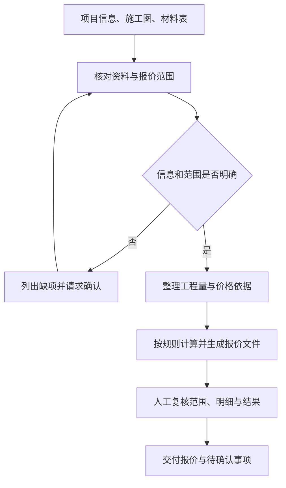
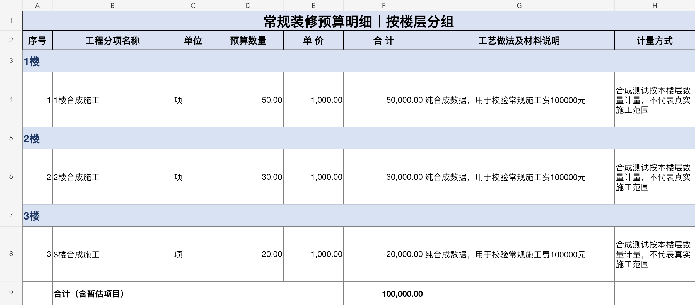

# 通用 AI 施工报价工具

**将施工报价经验整理成可复用、可按项目配置的 AI 工作流程。**

面向装修、工装及商业空间的施工报价，将资料核对、范围确认、计算、报价文件输出与人工复核组织成通用流程。使用时，根据具体项目配置工程量、材料选型和价格依据。

项目由丁雨推进，覆盖需求梳理、业务规则整理、AI 工作流配置、结果复核与迭代。工具已封装为 Skill，供业务人员在配置好的环境中使用。

> 项目案例展示，完整工具不公开提供。页面中的报价图片使用合成验算数据，不包含真实客户资料。

## 项目成果

| 观察项 | 已确认的业务使用情况 |
| --- | --- |
| 应用范围 | 已覆盖 11 个实际报价项目 |
| 整体报价周期 | 由约 3–7 个工作日缩短至约 1 个工作日 |
| 使用方式 | 业务人员提供项目信息、施工图和材料表，按流程完成确认 |
| 正式交付 | 报价结果经人工复核后使用 |

以上来自项目负责人的业务使用记录，与下文的软件测试分开说明。报价周期包含资料整理、确认、制作和复核，不等同于 AI 单次生成耗时；不据此推导准确率或成本节省比例。

## 业务问题

施工报价同时涉及范围、工程量、材料选型和费用计算。资料不完整或不同人员的判断口径不一致，容易造成反复确认、漏项、重复计价，以及后续修改难以追溯。

本项目把报价前必须确认的信息、计算口径、输出要求和复核步骤整理为标准流程，让 AI 按既定规则协助制作报价。

## 我的贡献

1. **梳理需求与输入。** 明确项目基础信息、施工图、材料表及范围确认的要求。
2. **整理业务规则。** 将报价范围、缺项追问、计算和输出要求写成 SOP，并组织成可复用流程。
3. **配置 AI 应用。** 将流程封装为 Skill，结合 AI 辅助的计算和表格生成能力完成交付。
4. **验证与迭代。** 经 3 轮规则与计算逻辑迭代，并结合施工人员复核反馈调整使用流程。

项目体现的是业务数字化与 AI 应用落地能力，包括需求分析、规则表达、工具配置、验证和人员使用支持。

## 工作流程

资料不足时先提出需要补齐或确认的问题；是否采用暂估需要明确依据和适用范围。

## 输出示例

以下为 Skill 1.1.0 实际运行后生成的合成验算结果。图片展示分层组织与可复核的明细结构，数值不代表市场价格。

完整交付组织为 11 张工作表，覆盖报价汇总、装修、水电、主材，以及工程量假设、价格来源、缺项风险、询价、差异分析和人工费参考等内容。展示仓库仅保留结果图片。

## 验证记录

2026-10-22 在 Python 3.12.14 环境重新执行发布包验证：

| 检查内容 | 本次结果 |
| --- | --- |
| 文件完整性 | 通过 |
| 规则及导出回归测试 | 75 项通过 |
| 楼层分组合成样例 | 成功生成 11 表 Excel 和辅助记录 |
| 测试覆盖示例 | 缺项阻断、范围确认、数值计算、楼层分组、公式与缓存 |

测试证明已覆盖场景中的程序行为，不证明图纸识别、工程量或市场价格在所有项目中准确。正式报价仍需人工复核。

## 使用边界

- 不自动识别或保证所有施工图和现场条件正确。
- 不内置可直接套用的市场价格库。
- 资料缺失、暂估依据和待确认范围需在报价中明确说明。
- 本次重新验证的是 Python 程序与导出流程；未重新开展各客户端的现场使用验收。

完整工具、内部规则和模板保存在私有仓库。面试交流可围绕业务问题、规则设计、输出结果和复核方式展开。
