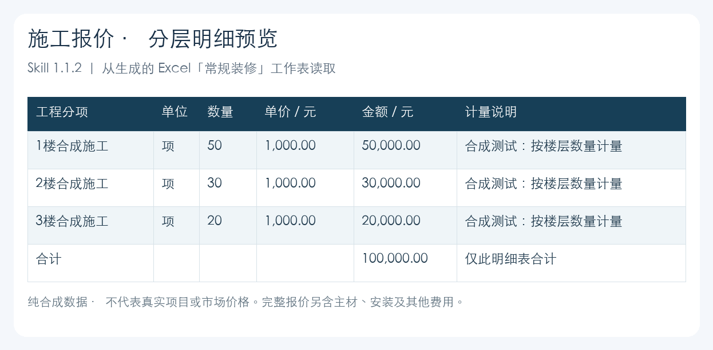

# 通用 AI 施工报价工具

将施工报价经验整理为可复用、可按项目配置的 AI 工作流程，连接资料核对、范围确认、费用计算、Excel 输出与人工复核。

**项目案例展示，完整工具不公开提供。** 当前案例对应 Skill **1.1.2**，适用于装修、工装及商业空间的预算测算和报价初稿。

## 业务问题

施工报价涉及范围、工程量、材料选型和费用计算。资料不完整、人员判断口径不同，容易造成反复确认、漏项、重复计价，以及后续修改难以追溯。

项目将报价前需要确认的信息、计算口径、输出要求和复核步骤整理为标准流程，让 AI 协助完成资料整理与报价制作。

## 个人贡献

项目由丁雨推进，工作覆盖需求梳理、业务规则整理、AI 工作流配置、结果复核和迭代：

- 把业务中的口头要求整理为输入字段、确认项和范围边界。
- 将工程量、材料和价格依据纳入记录，区分已确认信息与暂估内容。
- 连接资料整理、程序计算、Excel 输出和人工复核，减少过程中的信息断点。
- 结合施工人员复核反馈调整使用流程，并以程序回归检查验证规则与导出行为。

## 工作流程

AI 整理信息和提出待确认问题；程序执行既定计算。正式使用前，由项目人员复核数量、价格、范围及现场条件。

## 成果与示例

| 业务使用记录 | 已确认口径 |
|---|---|
| 使用范围 | 覆盖 11 个实际项目 |
| 整体报价周期 | 由约 3–7 个工作日缩短至约 1 个工作日 |
| 正式报价 | 经人工复核后使用 |

上述为业务使用记录，描述整个报价流程，不能作为 AI 单次运行时长或准确率结论。

图为 Skill 1.1.2 生成的合成 Excel 数据预览，展示分层明细与量价依据。数值用于功能验证，不代表真实项目或市场价格。

## 验证记录

2026-11-04 使用 Python 3.12 对指定发布包重新验证：

| 检查内容 | 验证结果 |
|---|---|
| 原始发布文件 | 15 个文件逐一核对 |
| 计算及导出回归检查 | 75 项通过 |
| Excel 结构 | 11 个工作表 |
| 固定合成验算 | 总额 168,504.66 元，与预期一致 |

程序测试验证已覆盖的计算、校验和导出行为，不代表任意图纸、工程量或市场价格均能自动处理。

## 适用边界

- 工程量、材料选型、现场条件和价格依据需要按项目确认。
- 缺少资料时，应继续补充或明确标注暂估。
- 不保证自动识图及实时市场价格准确，也不替代项目人员对正式报价的复核。

完整 Skill、计算脚本、内部规则和模板保存在私有仓库。此处只展示业务方法、合成结果与验证摘要。

相关案例：[室内施工图初审](https://github.com/tintin-dingyu/ai-interior-drawing-review-case)。
